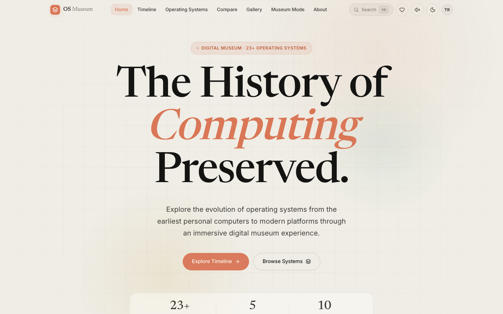
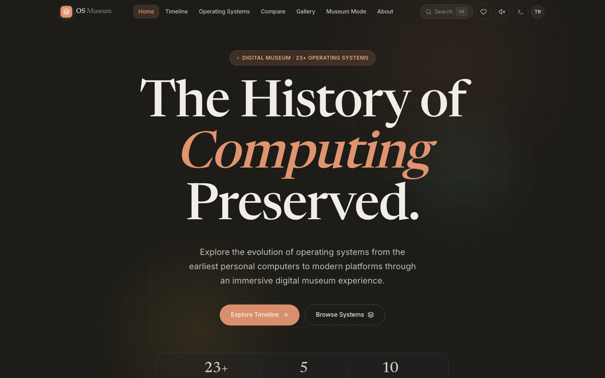
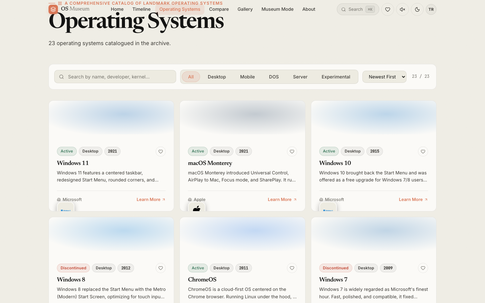
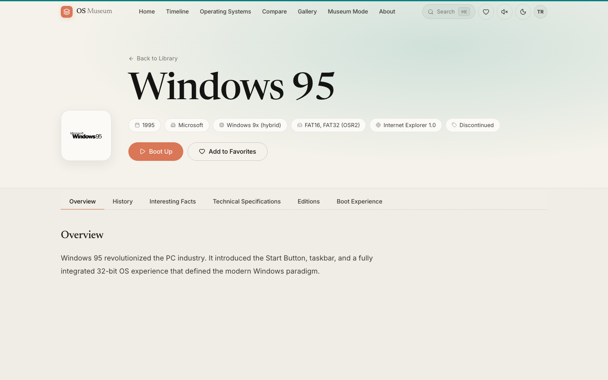
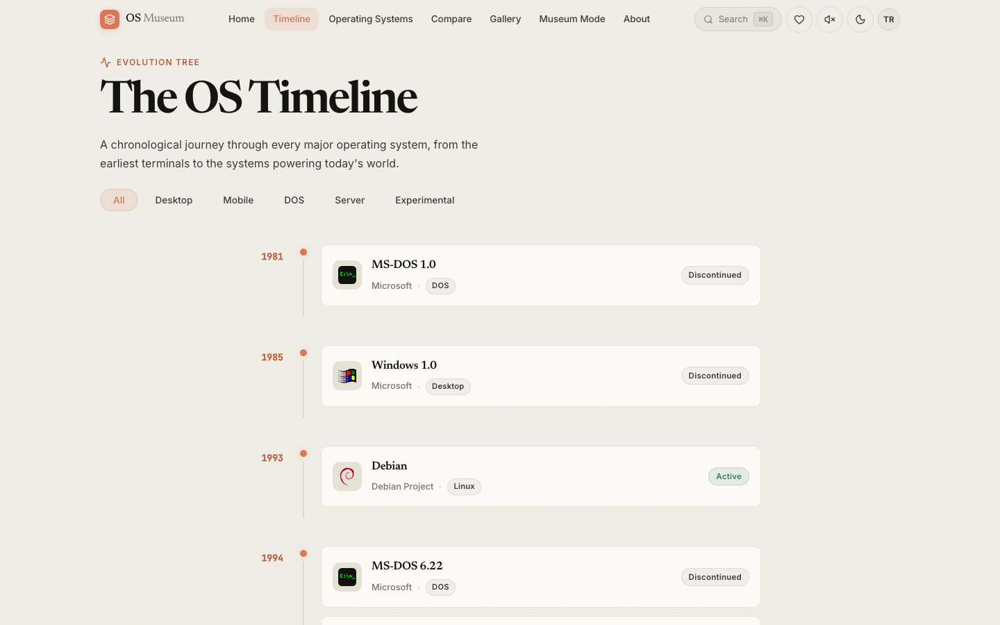

<div align="center">



<p>
  <a href="https://osmuseum.vercel.app/"></a>
  
  
  
</p>

<p><em>A curated, interactive archive of 23 operating systems across five decades.<br>
Every entry is a full exhibit: history, specs, trivia, editions and a boot you can watch.</em></p>

<a href="https://osmuseum.vercel.app/"></a>

</div>


## Three atmospheres

The whole museum lives in one of three moods, swapped with a single toggle:

- **Daylight**: warm cream canvas, editorial serif display, espresso ink. The default.
- **After-hours**: the archive after closing, in warm charcoal with coral lamplight.
- **Retro CRT**: phosphor green, scanlines and flicker for the true believers.

<table>
  <tr>
    <td width="50%"></td>
    <td width="50%"></td>
  </tr>
  <tr>
    <td align="center"><code>daylight</code></td>
    <td align="center"><code>after-hours</code></td>
  </tr>
</table>


## The wings

| Wing | What it does |
|---|---|
| **The Lobby** | A serif hero, a featured-systems rail, "On This Day" in computing history and browse-by-era shortcuts. |
| **The Archive** | All 23 systems as cards, searchable and filterable by category and status. |
| **The Exhibit Hall** | The full case file per system, from overview and history to specs and editions, plus a live boot simulator. |
| **The Timeline** | An evolution tree of releases since 1981, with predecessor and successor lineage. |
| **The Comparison Bench** | Any two systems side by side in a scrubbable split view. |
| **The Gallery** | A visual grid of every system's era, filterable by category. |
| **The Sound Room** | Startup chimes and boot sounds across the decades. |
| **The 3D Wing** | An interactive 3D museum built with React Three Fiber. |
| **The Collection** | Star systems and keep your own shelf, saved locally. |
| **Easter eggs** | A hidden terminal, a Konami-code surprise and a few more. |

<table>
  <tr>
    <td width="33%"></td>
    <td width="33%"></td>
    <td width="33%"></td>
  </tr>
  <tr>
    <td align="center"><code>archive</code></td>
    <td align="center"><code>exhibit</code> · with boot simulator</td>
    <td align="center"><code>timeline</code> · since 1981</td>
  </tr>
</table>


## The collection

| Wing | Systems |
|---|---|
| **DOS** | MS-DOS 1.0 (1981), MS-DOS 6.22 (1994), FreeDOS (1994) |
| **Desktop** | Windows 1.0 (1985), 95, 98, ME, XP, Vista, 7, 8, 10 and 11 (2021); Mac OS X 10.0 Cheetah (2001), macOS Monterey (2021); ChromeOS (2011) |
| **Linux** | Debian (1993), Fedora (2003), Ubuntu (2004) |
| **Mobile** | iOS (2007), Android (2008) |
| **Experimental** | ReactOS (1998), Haiku (2001) |


## What an exhibit holds

Every system is one entry in a single catalogue (`src/data/osData.js`), and every page in the museum reads from it, so the archive, the timeline, the comparison bench and the gallery never disagree.

| Field | Example (Windows 95) |
|---|---|
| Developer · release date | Microsoft · 24 August 1995 |
| Kernel · architecture | Windows 9x (hybrid) · x86 16/32-bit |
| File systems | FAT16, FAT32 (OSR2) |
| Lineage | Predecessor and successor, which draw the evolution tree |
| Status · end of life | Whether it is still supported, and since when not |
| Editions · system requirements · default browser | The practical detail of the time |
| History · interesting facts · description | The story, in Turkish and English |

The startup sounds in the Sound Room are synthesised with Web Audio oscillators; the museum ships no audio files.


## Two languages

Every label, exhibit and story exists in Turkish and English through `i18next`, switchable at any time; the chosen atmosphere is remembered between visits.


## Türkçe özet

**OS Museum**, beş on yıla yayılan 23 işletim sisteminin tarihini anlatan etkileşimli bir dijital müze. Her sistemin kendi sergi sayfası var: tarihçe, teknik özellikler, sürümler, ilginç bilgiler ve izlenebilir bir açılış simülasyonu. Zaman çizelgesi, iki sistemi yan yana karşılaştırma, açılış sesleri odası ve 3B müze kanadı da bulunuyor. Gündüz, mesai sonrası ve retro CRT olmak üzere üç atmosferi ve Türkçe/İngilizce arayüzü var.


## Development

```sh
npm install
npm run dev      # http://localhost:5173
npm run lint     # oxlint
npm run build
```

```
src/pages/       one page per wing and per exhibit
src/components/  cards, boot simulator, compare bench, 3D wing
src/data/        the 23-system catalogue
src/i18n/        Turkish and English strings
src/context/     theme and favourites
```

<div align="center">
<br>
<a href="https://github.com/kutluhangil"></a>
<sub>An independent history project · all trademarks belong to their respective owners · the screens in the banner are generic illustrations of each era.</sub>
</div>
