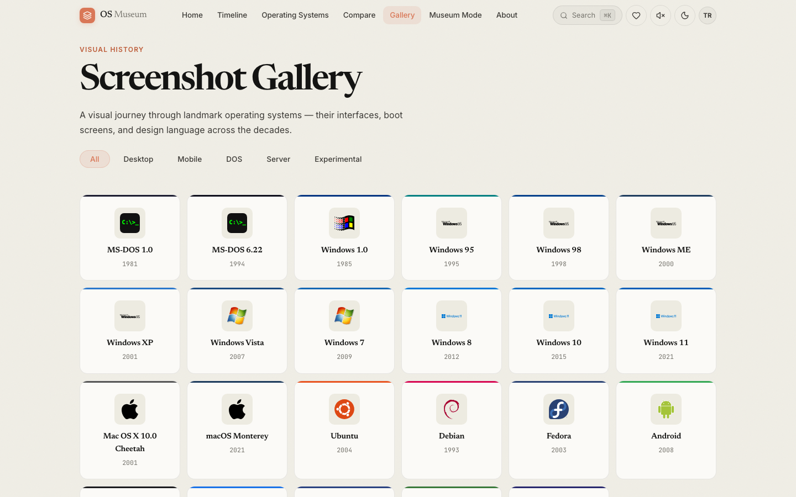

<div align="center">

<br />


<br /><br />

# OS Museum ✦

### The history of computing, preserved — *from the first command line to the modern desktop*.

[The Archive](#-whats-inside) · [The Exhibit Hall](#-the-exhibit-hall--every-system-boots) · [Tech Stack](#-tech-stack) · [Getting Started](#-getting-started)

</div>

---

## ✦ Overview

A curated, interactive archive of operating-systems history — **23 systems** spanning five decades, from MS-DOS to modern platforms. Every entry is a full exhibit: history, technical specs, trivia, editions, and a boot experience.

The whole museum lives in one of **three atmospheres**, swapped with a single toggle:

- **☀️ Daylight** — warm cream canvas, editorial serif display, espresso ink. The default.
- **🌙 After-hours** — the archive after closing: warm charcoal, lifted coral lamplight.
- **📟 Retro CRT** — phosphor green, scanlines, and flicker for the true believers.

<div align="center">
<br />


<br />
<em>Same museum, two atmospheres — daylight (left) and after-hours (right).</em>
</div>

---

## ⚡ What's inside

| Wing | What it does |
|------|-------------|
| 🏛️ **The Lobby** *(Home)* | Serif hero, featured systems rail, "On This Day" in computing history, and browse-by-era shortcuts. |
| 🗂️ **The Archive** *(Library)* | Every one of the 23 systems as a card — searchable and filterable by category and status. |
| 🖥️ **The Exhibit Hall** *(OS Detail)* | The full case file per system: overview, history, facts, specs, editions — plus a **live boot simulator**. |
| 🕰️ **The Timeline** | An evolution tree of releases from 1981 onward, with predecessor / successor lineage. |
| ⚖️ **The Comparison Bench** *(Compare)* | Put any two systems side by side with a scrubbable split view. |
| 🖼️ **The Gallery** | A visual grid of every system's mark and era, filterable by category. |
| 🔊 **The Sound Room** *(Sounds)* | Startup chimes and boot sounds across the decades. |
| 🧊 **The 3D Wing** *(Museum Mode)* | An interactive 3D museum built with React Three Fiber. |
| ⭐ **The Collection** *(Favorites)* | Star systems and keep your own curated shelf, saved locally. |
| 🥚 **Easter Eggs** | A hidden terminal, a Konami-code surprise, and a few more for the curious. |

---

## 🖥️ The Exhibit Hall — every system boots

The centrepiece. Each system has a full case file at `/os/:id` — release year, developer, kernel, filesystem, default browser, status, a written history, curated trivia, a technical spec table, editions, and predecessor / successor links.

Hit **Boot Up** and the system's startup sequence plays out in a simulated screen.

<div align="center">
<br />

<br />
<em>A single system's case file — tabbed exhibit with a live boot simulator.</em>
</div>

The rest of the museum:

- **The Archive** — 23 systems, live search across name / developer / description, category and status filters.
- **The Timeline** — a year-by-year evolution tree showing how each release descends from the last.
- **The Gallery** — every system's mark, colour-coded by era, filterable in place.

<div align="center">
<br />


<br />
<em>The Archive (left) and the Gallery (right).</em>
<br /><br />

<br />
<em>The Timeline — five decades of releases, logged.</em>
</div>

> **Note:** the museum runs entirely client-side. All 23 systems live in a single data file — no backend, no database, no API keys.

---

## 🛠️ Tech Stack

```
Core              →  React 19 · JavaScript (JSX) · Vite 8
Styling           →  Design-token CSS · Newsreader / Inter / JetBrains Mono
Animations        →  Framer Motion (hero reveals, section transitions, theme swap)
3D                →  Three.js · @react-three/fiber · @react-three/drei
Routing           →  React Router 7
i18n              →  i18next · react-i18next  (English / Türkçe)
Icons             →  lucide-react
Theming           →  Light (cream) · Dark (charcoal) · Retro (CRT) — persisted locally
Lint / Build      →  Oxlint · Vite
```

All system data lives in [`src/data/osData.js`](src/data/osData.js) — edit that one file to add or change a system; never the components.

---

## 🚀 Getting Started

### Prerequisites
- Node.js `>= 18`
- npm

### Local development

```bash
git clone https://github.com/kutluhangil/Operating-Systems-Museum.git
cd Operating-Systems-Museum
npm install

# Dev server → http://localhost:5173
npm run dev
```

### Other scripts

```bash
npm run build     # production build → dist/
npm run preview   # serve the production build locally
npm run lint      # Oxlint
```

---

## 📐 Project Structure

```
Operating-Systems-Museum/
├── public/                     # Static assets (favicon, OS logos)
├── src/
│   ├── components/
│   │   ├── layout/             # Navbar · Footer · Layout
│   │   ├── ui/                 # OSCard · BootSimulator · CompareSlider · SearchOverlay · …
│   │   └── 3d/                 # ExhibitPedestal (React Three Fiber)
│   ├── pages/                  # Home · Library · OSDetail · Timeline · Compare
│   │                           # Gallery · SoundGallery · MuseumMode · Museum3D · About · Favorites
│   ├── context/                # ThemeContext · FavoritesContext
│   ├── data/osData.js          # ← all system data lives here
│   ├── i18n/                   # en.json · tr.json
│   ├── hooks/                  # useKonamiCode
│   ├── utils/                  # SoundManager
│   └── index.css               # design tokens + base components
├── docs/screenshots/           # README imagery
├── vite.config.js
└── package.json
```

---

## ☁️ Deployment

Built as a **static SPA** with Vite — `npm run build` emits everything to `dist/`, which serves from any static host (Vercel, Netlify, GitHub Pages, an S3 bucket). Client-side routing is handled by React Router, so configure the host to rewrite unknown paths to `index.html`.

---

## 🤝 Contact

* GitHub — [kutluhangil](https://github.com/kutluhangil)
* LinkedIn — [Kutluhan Gül](https://linkedin.com/in/kutluhangil)

---

<div align="center">

Built by hand. ✦ © 2026 Kutluhan Gül

</div>
